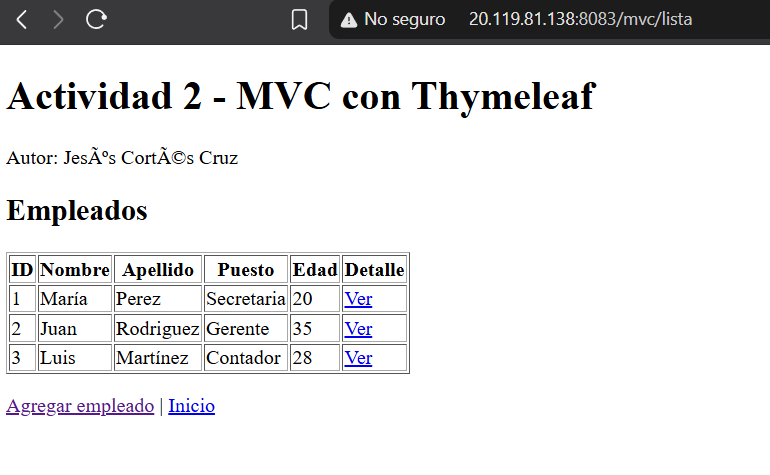
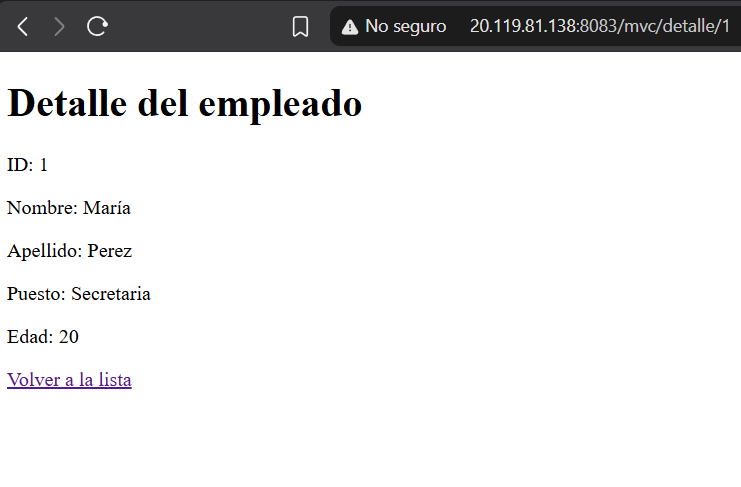
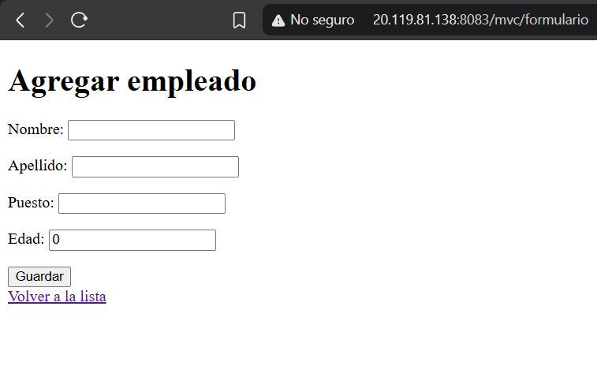
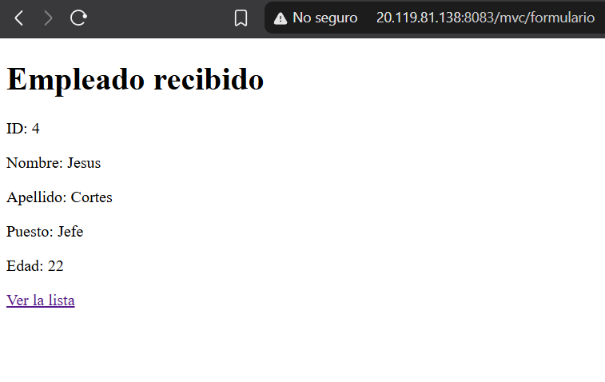
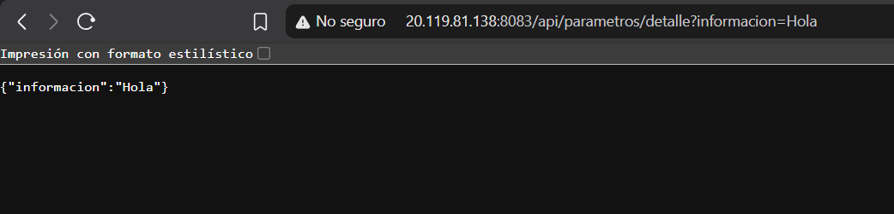
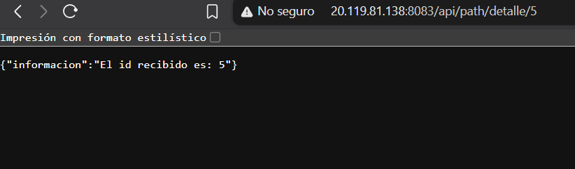
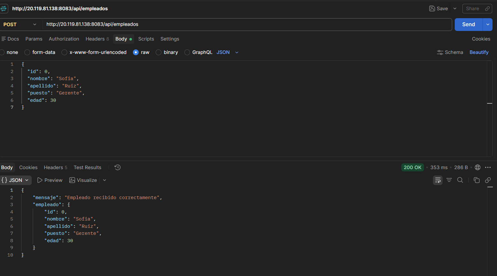

# JCCact2_t4

**Instituto Tecnológico de Oaxaca**  
**Materia:** Programación Web  
**Alumno:** Jesús Cortés Cruz

## Descripción

Proyecto de Spring Boot que implementa el patrón Modelo-Vista-Controlador (MVC) utilizando Thymeleaf para generar vistas HTML dinámicas. También expone una API REST para recibir información de empleados en formato JSON mediante solicitudes POST.

El proyecto fue probado localmente y desplegado en una máquina virtual de Azure, utilizando un puerto diferente al de la Actividad 1 para permitir que ambas aplicaciones funcionen simultáneamente.

## Tecnologías

- Java 21
- Spring Boot
- Maven
- Thymeleaf
- HTML
- API REST
- Nginx
- Azure Virtual Machine

## Estructura

- **InicioController:** muestra la página principal con enlaces a las diferentes funcionalidades del proyecto.
- **EmpleadoViewController:** administra las vistas de empleados, muestra una lista, permite consultar detalles y registra nuevos empleados mediante formularios.
- **EmpleadoApiController:** recibe empleados mediante solicitudes POST en formato JSON.
- **EjemploController:** proporciona información mediante una vista MVC.
- **EjemploRestController:** devuelve información en formato JSON.
- **PathVariableController:** recibe parámetros directamente desde la ruta mediante `@PathVariable`.
- **RquestParamControllers:** recibe parámetros mediante `@RequestParam`.
- **EmpleadoDTO:** objeto utilizado para transportar la información de los empleados.

## Funcionalidades y endpoints

### Vistas MVC

- `/` : página principal del proyecto.
- `/mvc/lista` : muestra la lista de empleados utilizando Thymeleaf.
- `/mvc/detalle/1` : muestra los detalles de un empleado.
- `/mvc/formulario` : presenta el formulario para registrar empleados.

### API REST

- `/api/detalles_info` : devuelve información mediante una vista.
- `/api/detalles_info2` : devuelve información del proyecto en formato JSON.
- `/api/empleados` : recibe información de un empleado mediante el método POST.

### Parámetros

- `/api/parametros/detalle?informacion=Hola` : recibe información mediante `@RequestParam`.
- `/api/path/detalle/5` : recibe un identificador mediante `@PathVariable`.

## Cuestionario

**a) ¿Qué es MVC y qué componentes lo forman en tu proyecto?**

MVC significa Modelo-Vista-Controlador. Es un patrón de diseño que organiza una aplicación en tres partes: el Modelo, que representa los datos y la información; la Vista, que muestra la información al usuario; y el Controlador, que recibe las peticiones y conecta el modelo con la vista.

En este proyecto, los DTO representan la información de los empleados, las vistas HTML con Thymeleaf muestran los datos y los controladores administran las solicitudes y las respuestas.

**b) ¿Qué es un DTO y por qué no se debe exponer directamente una entidad?**

DTO significa Data Transfer Object y es un objeto utilizado para transportar información entre diferentes partes de una aplicación. En este proyecto se utiliza `EmpleadoDTO` para manejar los datos de los empleados, como su ID, nombre, apellido, puesto y edad.

Es conveniente utilizar DTO porque permite controlar qué información se recibe o se envía, evita exponer directamente la estructura interna de una entidad y facilita la validación y el mantenimiento del código.

**c) ¿Cuál es la diferencia entre @ModelAttribute y @RequestBody?**

`@ModelAttribute` se utiliza para recibir información de formularios HTML y relacionarla con un objeto Java. En este proyecto se utiliza para recibir los datos del formulario de empleados.

`@RequestBody` se utiliza para recibir información enviada en el cuerpo de una petición HTTP, generalmente en formato JSON. En este proyecto se utiliza en el controlador REST para recibir un objeto `EmpleadoDTO` mediante una solicitud POST.

**d) ¿Qué puerto se utilizó en el VPS y por qué?**

Se utilizó el puerto **8083**, configurado manualmente en el archivo `application.properties` mediante la propiedad `server.port=8083`.

Se eligió este puerto para evitar conflictos con la Actividad 1, que continúa funcionando en el puerto 8081. De esta manera, ambas aplicaciones pueden ejecutarse simultáneamente en la misma máquina virtual de Azure. También se configuró una regla de entrada en el grupo de seguridad de red de Azure para permitir el acceso al puerto 8083.

## Enlaces

**Repositorio de GitHub:**  
https://github.com/JesusCortes-designer/JCCact2_t4

**Proyecto en el VPS:**  
http://20.119.81.138:8083/

**Lista de empleados:**  
http://20.119.81.138:8083/mvc/lista

**Formulario de empleados:**  
http://20.119.81.138:8083/mvc/formulario

**Actividad 1:**  
http://20.119.81.138:8081/

## Cómo generar el JAR

Ejecutar el siguiente comando desde la carpeta del proyecto:

```bash
./mvnw clean package -DskipTests
```

El archivo JAR generado se encuentra dentro de la carpeta `target`.

## Despliegue en Azure

La aplicación se encuentra desplegada en una máquina virtual de Azure con Ubuntu 24.04 y Java 21.

Se configuró como un servicio de `systemd` para que pueda ejecutarse en segundo plano y reiniciarse automáticamente cuando sea necesario.

El servicio utilizado es `springapp2.service` y la aplicación funciona en el puerto 8083.

La Actividad 1 permanece funcionando en el puerto 8081, por lo que ambas aplicaciones pueden ejecutarse al mismo tiempo.

## Pruebas en localhost

Se ejecutó el proyecto localmente mediante el siguiente comando:

```powershell
.\mvnw.cmd spring-boot:run
```

Se realizaron pruebas desde el navegador para comprobar el funcionamiento de las vistas MVC y los diferentes endpoints.

### Lista de empleados



### Detalle de empleado



### Formulario de empleados



### Resultado del formulario



### Parámetros con @RequestParam



### Parámetros con @PathVariable



### API REST con POST

La API se probó mediante Postman utilizando el método POST y enviando un objeto JSON.

**Endpoint:**

`http://localhost:8083/api/empleados`

**Ejemplo de JSON enviado:**

```json
{
  "id": 0,
  "nombre": "Sofia",
  "apellido": "Ruiz",
  "puesto": "Gerente",
  "edad": 30
}
```



## Pruebas en el VPS

El proyecto se desplegó en la máquina virtual de Azure y se comprobó su funcionamiento utilizando la IP pública del servidor y el puerto 8083.

### Página principal


### Lista de empleados


### Formulario de empleados


### API REST

Se comprobó el funcionamiento del endpoint POST mediante una solicitud a la dirección:

`http://20.119.81.138:8083/api/empleados`


## Alumno

**Jesús Cortés Cruz**  
Instituto Tecnológico de Oaxaca  
Programación Web